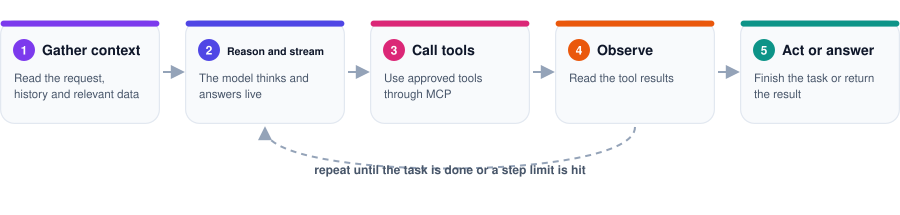
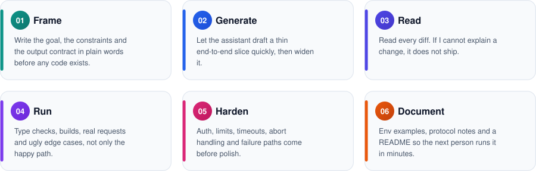
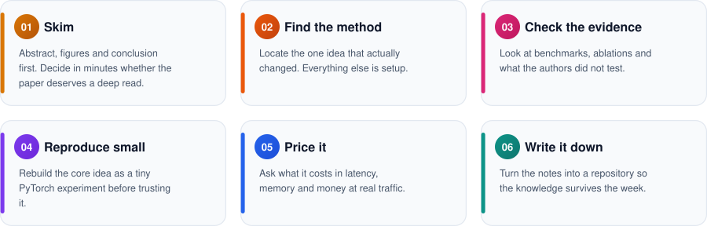
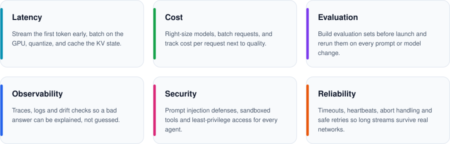
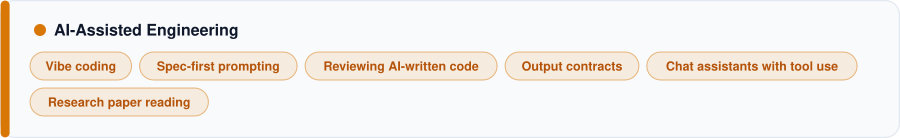

<div align="center">


<p>
<a href="mailto:vijay.aieng@gmail.com"></a>&nbsp;
<a href="https://www.linkedin.com/in/vijay-aieng/"></a>&nbsp;
<a href="https://vijayai.site"></a>&nbsp;
<a href="https://github.com/VijayAIeng"></a>
</p>

</div>

<br/>


<br/>

I am an AI/ML Engineer working across language models, speech technology, retrieval systems, and AI application infrastructure. My work includes connecting models to real products, improving inference and retrieval workflows, and building services that can be evaluated, deployed, and maintained.

My current focus is agentic systems: software where a model reads context, calls tools, observes results, and keeps going until the job is done. At work I contribute to an internal AI product built on these ideas (the details are confidential), and I care most about the unglamorous parts: clean protocols, safe tools, and recovery when things fail.

I use Python and PyTorch for model development, TypeScript and Next.js for product surfaces, and tools such as Hugging Face Transformers, LangChain, LangGraph, vector databases, FastAPI, Docker, and Kubernetes to build end-to-end systems. I work with AI coding assistants every day and stay responsible for design, review, and verification.

I am most interested in roles where model understanding and software engineering meet: building useful AI features, investigating performance bottlenecks, and making model-backed applications dependable in production.

<br/>


<br/>


<br/>


<br/>

In my current role I also work on an internal AI product that turns natural-language requests into editable web pages. The details are confidential, so I only share the overall picture.


<br/>


<br/>

An agent is a loop: gather context, let the model reason, call a tool, read the result, and repeat until the task is done. MCP (Model Context Protocol) is the standard way to give the model tools, so the host controls exactly what those tools may touch.



### How tool use works, step by step

1. The client asks an MCP server which tools it offers (`tools/list`) and passes each tool's JSON Schema to the model.
2. The model streams text and, when it needs something, emits a tool call with arguments.
3. The host runs the call (`tools/call`) inside its own permission boundary.
4. The result returns as a tool message, and the model continues with the new information.
5. The loop ends when the model finishes or a step limit is reached.

A generic MCP request looks like this:

```json
{
  "jsonrpc": "2.0",
  "id": 1,
  "method": "tools/call",
  "params": { "name": "search_documents", "arguments": { "query": "refund policy" } }
}
```

Streaming interfaces send small typed events, one per line, so the interface can show progress live:

```json
{"type":"thinking","delta":"Checking the policy documents..."}
{"type":"tool_call","id":"t1","name":"search_documents","args":{"query":"refund policy"}}
{"type":"text","delta":"The refund window is..."}
{"type":"done"}
```

### What I know about agent systems

| Concept | How I apply it |
|---|---|
| **Tool design** | Small, single-purpose tools with JSON Schema inputs, clear descriptions, and required fields, so models call them correctly. Errors come back as readable text the model can recover from. |
| **Context building** | Summarize large state before it reaches the model, with hard size caps, so big inputs never overflow the prompt. |
| **Client tools and server tools** | Tools the host executes are kept separate from tools the backend ran itself, which are reported as information only. |
| **Streaming** | Typed events for thinking, text, tool calls, tool results, and errors, so the interface stays responsive. |
| **Memory** | Server-side conversation memory, local chat history, and a fresh-thread fallback when state goes missing. |
| **Guardrails** | Step limits, abort control, path sandboxing, authentication, size limits, and read-only modes. |
| **Review and undo** | Proposed changes pass through a review step, and automated edits are grouped so they can be undone in one action. |

### Chat assistants with MCP

In chat assistants that support connectors, MCP gives the model access to files, search, calendars, and design tools. I design those tools like a public API: narrow scope, safe defaults, permissions enforced on the server and never trusted to the prompt, and every dangerous action isolated behind an explicit tool.

<br/>


<br/>

I use AI coding assistants as fast collaborators and keep myself responsible for design and verification. The assistant makes the first draft cheap, and my time goes into the parts that decide quality: the contract, the review, and the failure paths.



### Vibe coding, with engineering discipline

I describe intent and constraints, let the assistant produce a draft quickly, and then switch to engineering mode: read, run, break, and fix. Vibe coding is how I move fast. Reviewing is how I stay trustworthy.

**Rules I follow**

- I never merge code I cannot explain.
- The output contract is written down before generation starts: exactly what format the model must return and what it must never do.
- I ask the assistant to explain trade-offs, not only to write code.
- I test failure paths first: bad input, missing files, dropped streams, and hostile paths.
- Secrets stay out of prompts and out of generated code. Configuration lives in environment variables with a documented example file.
- I prefer a small hand-written module over a new dependency when the module is simple enough to own.

### Thinking inside a time box

1. **Settle the contract first.** Types, event protocol, folder layout, and what each tool may touch.
2. **Build the thinnest end-to-end slice.** One request flowing from input to a saved result.
3. **Widen only after the slice works.** Extra features, settings, and history come after the core loop is proven.
4. **Harden before polishing.** Auth, limits, and recovery come before visual refinement.
5. **Write it down while it is fresh.** Every project gets an install guide, an environment example, and protocol notes.

<br/>


<br/>

I read research to decide what is worth building, not to collect papers. Every paper gets the same routine, and anything that survives it becomes a small experiment in a repository.



**My note template for any research page**

```text
Title:
One-sentence idea:
What changed compared with the baseline:
Evidence I trust, and evidence I do not:
Tiny experiment to run:
Production cost (latency, memory, money):
Decision: build, watch, or skip
```

**Where I practice what I read**

| Topic | Repository |
|---|---|
| KV cache, batching, quantization, speculative decoding | [LLM Inference](https://github.com/VijayAIeng/llm-inference-from-scratch-to-production) |
| Mixture of experts and expert routing | [Mixture of Experts from Scratch](https://github.com/VijayAIeng/moe-from-scratch) |
| SFT, LoRA, QLoRA, PEFT, DPO | [LLM Fine-Tuning](https://github.com/VijayAIeng/llm-finetuning-from-scratch-to-production) |
| DDP, FSDP, tensor and pipeline parallelism | [Distributed AI Training](https://github.com/VijayAIeng/distributed-ai-training-from-scratch) |
| Hybrid search and reranking | [Complete RAG from Scratch to Production](https://github.com/VijayAIeng/Complete-rag-from-scratch-to-production) |
| Prompt injection, jailbreaks, agent security | [AI Safety, Security and Guardrails](https://github.com/VijayAIeng/ai-safety-security-and-guardrails) |
| Evaluation, tracing, monitoring | [LLMOps](https://github.com/VijayAIeng/llmops-from-development-to-production) |

<br/>


<br/>

A demo works once. A production system works on a bad network, with hostile input, at a cost the business can afford. These are the six questions I ask before anything ships.



**My definition of done**

- A request can be traced from the browser to the model and back.
- A failure shows a readable error, never a blank screen.
- Secrets live in environment variables, and the repository includes an example file.
- Every tool an agent can call has limits on paths, size, and permissions.
- There is an evaluation set, and I know the number before and after each change.
- Long streams survive idle timeouts, dropped connections, and user cancellation.

<br/>


<br/>


<br/>


<br/>


<br/>


<br/>


- **Conversational voice AI:** Developed a streaming pipeline connecting Whisper, Llama 3, and XTTS-v2 through WebSockets and Kubernetes. Project measurements reported sub-500 ms latency and a 30% infrastructure cost reduction after GPU batching and quantization.
- **Enterprise retrieval:** Built a hybrid retrieval workflow with BGE-M3, Weaviate, and Neo4j for a document collection reported at more than one million documents.
- **Speech and vision workflows:** Worked on multilingual text-to-speech and vision-based retrieval, including vector indexing and application integration.
- **Agent workflows:** Implemented tool-using LLM workflows with LangGraph and CrewAI, including persistent context and multi-step task execution.
- **Speech research:** Contributed to Shabdh, a multilingual zero-shot voice-cloning project presented at LIMMITS'24 and LIMMITS'25.


- Fine-tuned speech recognition and synthesis models using multilingual audio data and parameter-efficient methods.
- Worked with LoRA/PEFT, model evaluation, MLflow, and CI/CD workflows.
- Recorded an 18% word error rate on one ASR project.


- Built and evaluated classification, regression, and NLP models for applied data science tasks.
- Compared model results and summarized findings to support data-informed decisions.

<br/>


<br/>

<table>
<tr>
<td width="50%" valign="top"></td>
<td width="50%" valign="top"></td>
</tr>
<tr>
<td width="50%" valign="top"></td>
<td width="50%" valign="top"></td>
</tr>
</table>

<br/>


<br/>

<p></p>

<p></p>

<p></p>

<p></p>

<p></p>

<p></p>

<p></p>

<p></p>

<p></p>

<p></p>

<br/>


<br/>

I use these repositories to organize implementations, notes, experiments, and end-to-end engineering workflows. Open a repository for its source code, examples, and setup instructions.

<details open>
<summary><strong>LLMs, Transformers, and Agents (9)</strong></summary>

<p></p>

| Repository | What it covers |
|---|---|
| [LLMs from Scratch to Production](https://github.com/VijayAIeng/llms-from-scratch-to-production) | Pretraining concepts, fine-tuning, evaluation, inference, deployment |
| [Transformers from Scratch](https://github.com/VijayAIeng/transformers-from-scratch) | Attention, positional encoding, transformer architecture |
| [Agents from Scratch to Production](https://github.com/VijayAIeng/agents-from-scratch-to-production) | Planning, tools, memory, MCP, multi-agent workflows |
| [Production LLM Applications](https://github.com/VijayAIeng/production-llm-applications) | RAG, routing, caching, structured outputs, tool calling |
| [LLM Fine-Tuning](https://github.com/VijayAIeng/llm-finetuning-from-scratch-to-production) | SFT, LoRA, QLoRA, PEFT, DPO |
| [LLM Inference](https://github.com/VijayAIeng/llm-inference-from-scratch-to-production) | KV cache, batching, quantization, speculative decoding |
| [LLMOps](https://github.com/VijayAIeng/llmops-from-development-to-production) | Evaluation, tracing, monitoring |
| [LLM Data Processing Guide](https://github.com/VijayAIeng/complete-production-level-llm-data-processing-guide) | Cleaning, deduplication, tokenization, storage |
| [Mixture of Experts from Scratch](https://github.com/VijayAIeng/moe-from-scratch) | Expert routing and sparse activation |

</details>

<details>
<summary><strong>RAG, Search, and NLP (4)</strong></summary>

<p></p>

| Repository | What it covers |
|---|---|
| [Complete RAG from Scratch to Production](https://github.com/VijayAIeng/Complete-rag-from-scratch-to-production) | Chunking, embeddings, hybrid search, reranking |
| [Embeddings, Vector Search and Retrieval](https://github.com/VijayAIeng/Embeddings-Vector-Search-and-Retrieval) | Embedding models, vector indexes, similarity search |
| [NLP from Scratch to Production](https://github.com/VijayAIeng/natural-language-processing-from-scratch-to-production) | NLP fundamentals through transformer systems |
| [Databases for AI Engineering](https://github.com/VijayAIeng/databases-for-ai-engineering) | SQL, NoSQL, indexing, vector databases |

</details>

<details>
<summary><strong>Multimodal AI and Computer Vision (2)</strong></summary>

<p></p>

| Repository | What it covers |
|---|---|
| [Multimodal AI](https://github.com/VijayAIeng/multimodal-ai-from-fundamentals-to-production) | Text, images, audio, video, vision-language models |
| [Computer Vision](https://github.com/VijayAIeng/computer-vision-from-fundamentals-to-production) | CNNs, detection, segmentation, vision transformers |

</details>

<details>
<summary><strong>Infrastructure, MLOps, and Production (10)</strong></summary>

<p></p>

| Repository | What it covers |
|---|---|
| [Kubernetes for AI/ML](https://github.com/VijayAIeng/kubernetes-for-ai-ml) | GPU scheduling, autoscaling, model serving |
| [Cloud AI Engineering](https://github.com/VijayAIeng/cloud-ai-engineering) | Cloud compute, IAM, deployment, cost management |
| [Production AI Backend with FastAPI](https://github.com/VijayAIeng/production-ai-backend-with-fastapi) | Async APIs, authentication, streaming |
| [Distributed AI Training](https://github.com/VijayAIeng/distributed-ai-training-from-scratch) | DDP, FSDP, tensor and pipeline parallelism |
| [MLOps from Training to Production](https://github.com/VijayAIeng/mlops-from-training-to-production) | Tracking, versioning, CI/CD, model registry |
| [AI Observability and Reliability](https://github.com/VijayAIeng/ai-observability-and-reliability) | Logs, traces, drift detection, reliability |
| [AI Safety, Security and Guardrails](https://github.com/VijayAIeng/ai-safety-security-and-guardrails) | Prompt injection, jailbreaks, RAG and agent security |
| [Data Engineering for AI](https://github.com/VijayAIeng/data-engineering-for-ai) | ETL/ELT, Spark, Kafka, data lakes |
| [Production Python Engineering](https://github.com/VijayAIeng/production-python-engineering) | Concurrency, async, testing, packaging |
| [AI System Design](https://github.com/VijayAIeng/ai-system-design) | Architecture for LLM, RAG, and agent systems |

</details>

<details>
<summary><strong>Machine Learning Foundations (12)</strong></summary>

<p></p>

| Repository | What it covers |
|---|---|
| [Machine Learning from Fundamentals to Production](https://github.com/VijayAIeng/machine-learning-from-fundamentals-to-production) | Core ML workflows |
| [Machine Learning Model Evaluation](https://github.com/VijayAIeng/machine-learning-model-evaluation) | Metrics and evaluation methods |
| [Feature Engineering for ML](https://github.com/VijayAIeng/feature-engineering-for-machine-learning) | Feature preparation and selection |
| [Production Deep Learning with PyTorch](https://github.com/VijayAIeng/production-deep-learning-with-pytorch) | Training and deployment |
| [Production ML System](https://github.com/VijayAIeng/production-ml-system) | End-to-end ML system components |
| [PyTorch Optimization Algorithms](https://github.com/VijayAIeng/pytorch-optimization-algorithms) | Optimizers and training behavior |
| [ML Optimization from Scratch](https://github.com/VijayAIeng/ml-optimization-from-scratch) | Optimization fundamentals |
| [Linear Algebra for Machine Learning](https://github.com/VijayAIeng/Linear-Algebra-for-Machine-Learning) | Vectors, matrices, transformations |
| [Probability and Statistics for ML](https://github.com/VijayAIeng/probability-statistics-for-machine-learning) | Probability and statistical foundations |
| [Complete NumPy Guide](https://github.com/VijayAIeng/Complete-numpy-guide) | Numerical computing |
| [Complete PyTorch Guide](https://github.com/VijayAIeng/complete-pytorch-guide) | Tensor operations and model training |
| [Data Structures and Algorithms](https://github.com/VijayAIeng/data-structures-and-algorithms-from-scratch) | Core algorithms and problem solving |

</details>

<br/>


<br/>

**B.E. in Computer Science and Engineering**
Sasurie Academy of Engineering, Coimbatore | 2016 to 2020

**Courses and Certifications**

- DeepLearning.AI, LLM Specialization
- LangChain, Application Development
- Hugging Face, NLP Course
- fast.ai, Practical Deep Learning
- AWS Cloud Practitioner, in progress

<br/>


<br/>

<div align="center">

<p>
<a href="mailto:vijay.aieng@gmail.com"></a>&nbsp;
<a href="https://www.linkedin.com/in/vijay-aieng/"></a>&nbsp;
<a href="https://vijayai.site"></a>&nbsp;
<a href="https://github.com/VijayAIeng"></a>
</p>

</div>

<br/>


