

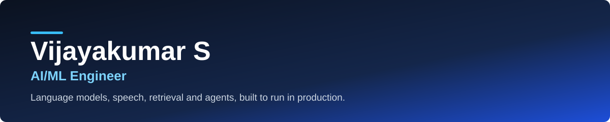

&nbsp;
&nbsp;
&nbsp;

 

 

Hi, I'm Vijay. I'm an AI/ML Engineer who works on language models, speech, retrieval and agents.

Right now I'm building **Brahm Studio**, an AI website builder for React sites. You can design a page by hand on a canvas, or ask an AI model to do it, and both work on the same page. My work is mostly the agent side: how the model gets context, which tools it can use, and what happens when something fails.

I like the boring parts of AI engineering the most. Clean tool contracts, safe permissions, streaming that does not break, and an undo button when the model gets it wrong.

I use AI coding assistants every day. They write the first draft, and I read it, run it, and break it before I trust it. I do not merge code I cannot explain.

 

 

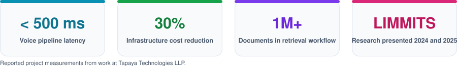

 

 

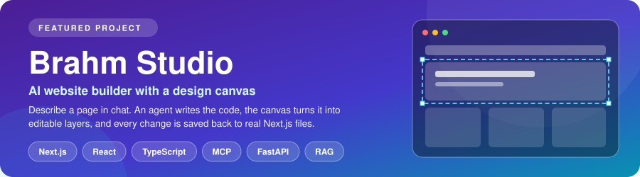

 

Brahm Studio mixes three things in one place: a chat assistant, a visual design canvas, and tool-using agents. You type what you want, and you get a React page you can keep editing by hand. The code is confidential, so I can only share the big picture.

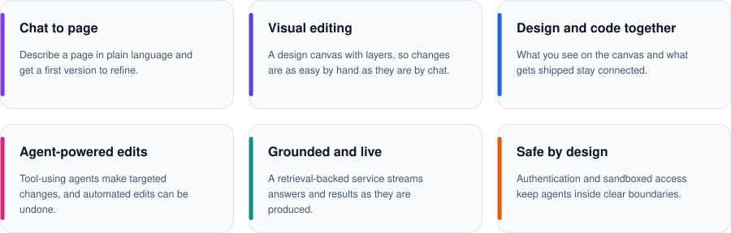

**What I do on it**

- Work across the UI, the agent layer and the backend.
- Design how an agent gets context, picks tools and recovers from errors.
- Keep it fast by streaming results live.
- Keep it safe with clear permissions, hard limits and one-click undo for AI changes.

 

 

An agent is a loop: read context, think, call a tool, look at the result, repeat. MCP is how I give the model tools in a standard way, so the host decides exactly what each tool can touch.

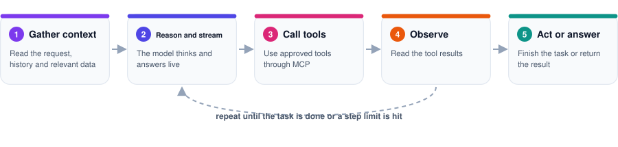

| What | How I do it |
|---|---|
| **Tools** | Small, single-purpose, with JSON Schema inputs. Errors come back as readable text so the model can fix itself. |
| **Context** | Summarize big state and cap the size so the prompt never overflows. |
| **Streaming** | Typed events for text, tool calls, results and errors. |
| **Guardrails** | Step limits, abort control, path sandboxing, auth and read-only modes. |
| **Review and undo** | Changes go through a review step and AI edits can be undone in one action. |

 

 

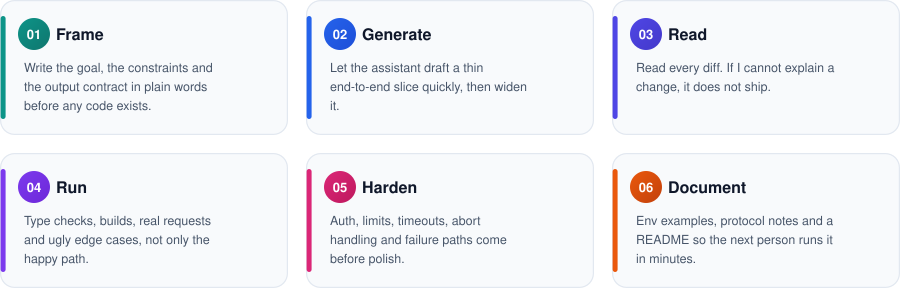

**My daily rules**

- Write the output contract first, then generate code.
- Ask the assistant for trade-offs, not only code.
- Test the failure paths first: bad input, dropped streams, hostile paths.
- Keep secrets out of prompts and code. Use env variables and an example file.
- Build the thinnest working slice first, then widen it.

 

 

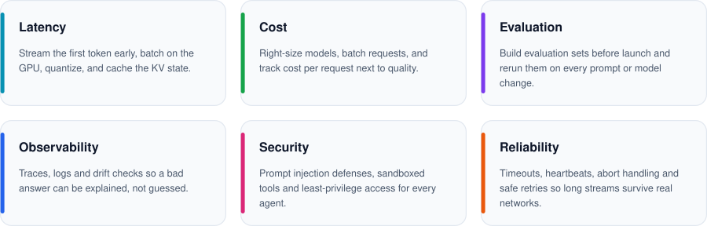

A demo works once. My "done" means a request can be traced end to end, failures show a clear error, every tool has limits, and I know my eval number before and after each change.

 

 

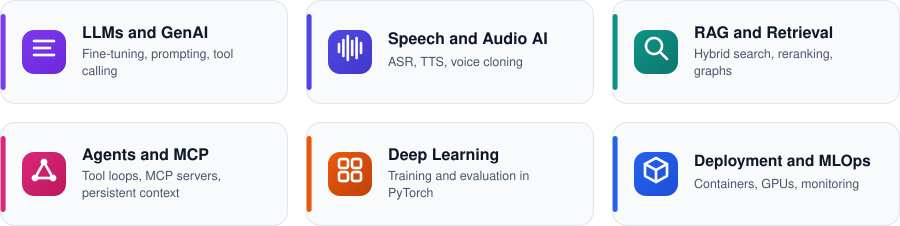

 

 

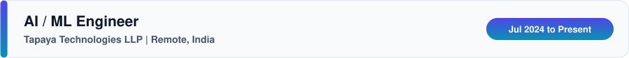

- **Brahm Studio:** React website builder with a design canvas and tool-using agents.
- **Voice AI:** Streaming pipeline with Whisper, Llama 3 and XTTS-v2 over WebSockets and Kubernetes. Sub-500 ms latency and 30% lower infra cost after GPU batching and quantization.
- **Enterprise retrieval:** Hybrid search with BGE-M3, Weaviate and Neo4j over a collection of more than one million documents.
- **Agent workflows:** LangGraph and CrewAI workflows with persistent context and multi-step tasks.
- **Research:** Shabdh, a multilingual zero-shot voice cloning project, presented at LIMMITS'24 and LIMMITS'25.

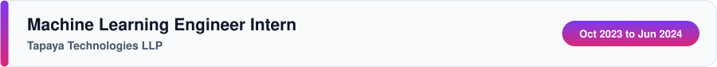

- Fine-tuned speech recognition and synthesis models with LoRA/PEFT on multilingual audio.
- Used MLflow and CI/CD for evaluation and tracking. Reached 18% word error rate on one ASR project.

- Built and evaluated classification, regression and NLP models.

 

 

<table>
<tr>
<td width="50%" valign="top">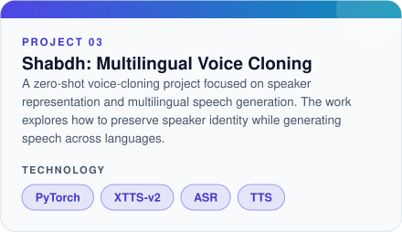</td>
<td width="50%" valign="top">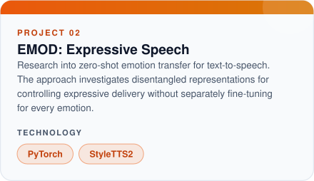</td>
</tr>
<tr>
<td width="50%" valign="top">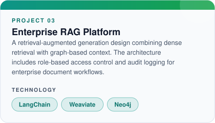</td>
<td width="50%" valign="top">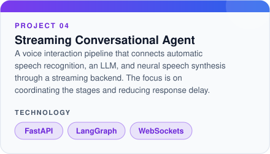</td>
</tr>
</table>

 

 

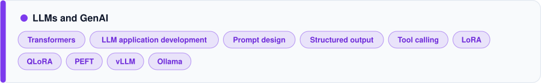

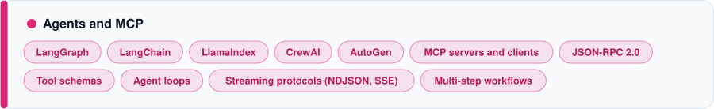

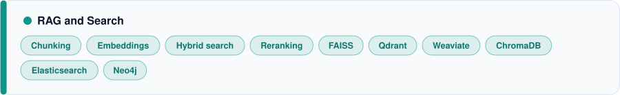

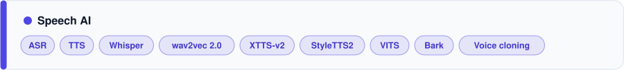

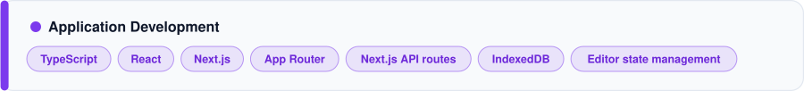

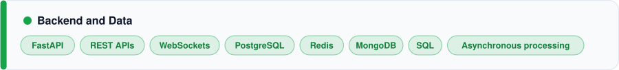

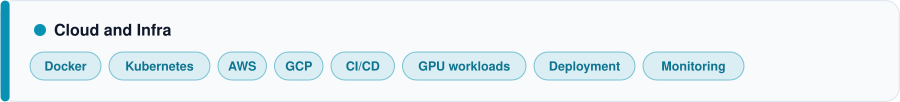

 

 

<strong>More repositories (ML, vision, data, infra)</strong>

 

 

 

**B.E. in Computer Science and Engineering**, Sasurie Academy of Engineering, Coimbatore, 2016 to 2020

- DeepLearning.AI, LLM Specialization
- LangChain, Application Development
- Hugging Face, NLP Course
- fast.ai, Practical Deep Learning
- AWS Cloud Practitioner, in progress

 

 

&nbsp;
&nbsp;
&nbsp;

 

