

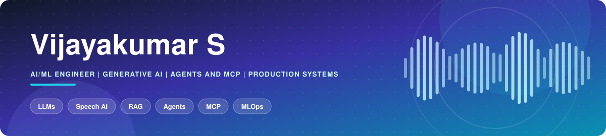

&nbsp;
&nbsp;
&nbsp;

 

 

I am an AI/ML Engineer working across language models, speech technology, retrieval systems, and AI application infrastructure. My work includes connecting models to real products, improving inference and retrieval workflows, and building services that can be evaluated, deployed, and maintained.

I use Python and PyTorch for model development, with tools such as Hugging Face Transformers, LangChain, LangGraph, vector databases, FastAPI, Docker, and Kubernetes to build end-to-end systems.

I am most interested in roles where model understanding and software engineering meet: building useful AI features, investigating performance bottlenecks, and making model-backed applications dependable in production.

 

 

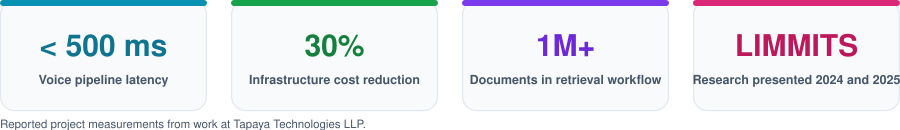

 

 

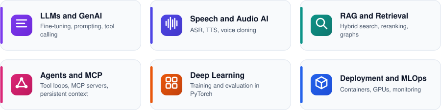

 

 

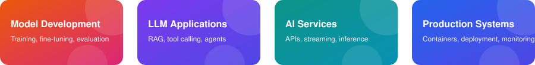

 

 

- **Conversational voice AI:** Developed a streaming pipeline connecting Whisper, Llama 3, and XTTS-v2 through WebSockets and Kubernetes. Project measurements reported sub-500 ms latency and a 30% infrastructure cost reduction after GPU batching and quantization.
- **Enterprise retrieval:** Built a hybrid retrieval workflow with BGE-M3, Weaviate, and Neo4j for a document collection reported at more than one million documents.
- **Speech and vision workflows:** Worked on multilingual text-to-speech and vision-based retrieval, including vector indexing and application integration.
- **Agent workflows:** Implemented tool-using LLM workflows with LangGraph and CrewAI, including persistent context and multi-step task execution.
- **Speech research:** Contributed to Shabdh, a multilingual zero-shot voice-cloning project presented at LIMMITS'24 and LIMMITS'25.

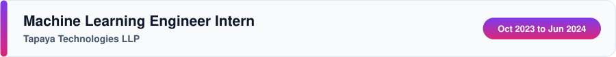

- Fine-tuned speech recognition and synthesis models using multilingual audio data and parameter-efficient methods.
- Worked with LoRA/PEFT, model evaluation, MLflow, and CI/CD workflows.
- Recorded an 18% word error rate on one ASR project.

- Built and evaluated classification, regression, and NLP models for applied data science tasks.
- Compared model results and summarized findings to support data-informed decisions.

 

 

<table>
<tr>
<td width="50%" valign="top">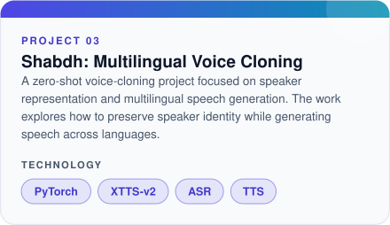</td>
<td width="50%" valign="top">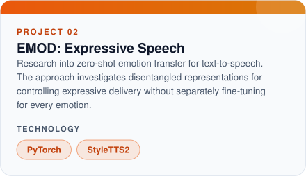</td>
</tr>
<tr>
<td width="50%" valign="top">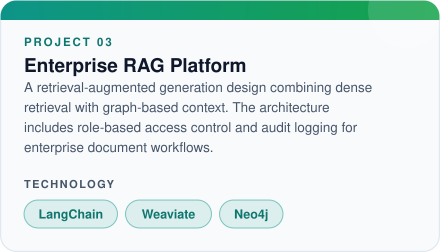</td>
<td width="50%" valign="top">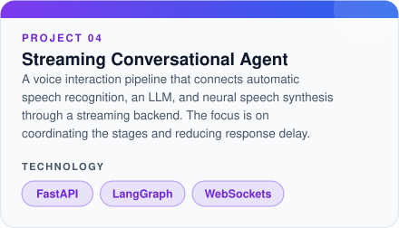</td>
</tr>
</table>

 

 

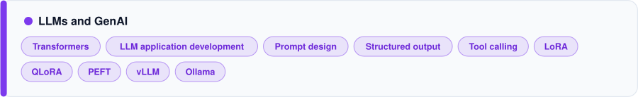

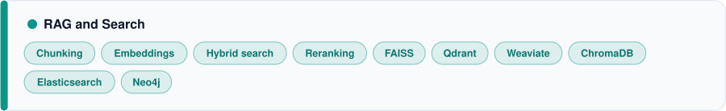

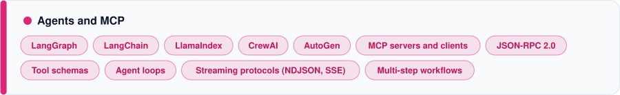

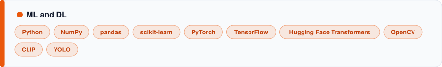

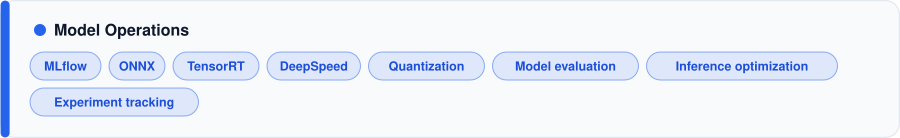

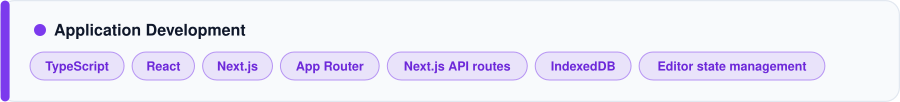

 

 

I use these repositories to organize implementations, notes, experiments, and end-to-end engineering workflows. Open a repository for its source code, examples, and setup instructions.

<strong>LLMs, Transformers, and Agents (9)</strong>

| Repository | What it covers |
|---|---|
| [LLMs from Scratch to Production](https://github.com/VijayAIeng/llms-from-scratch-to-production) | Pretraining concepts, fine-tuning, evaluation, inference, deployment |
| [Transformers from Scratch](https://github.com/VijayAIeng/transformers-from-scratch) | Attention, positional encoding, transformer architecture |
| [Agents from Scratch to Production](https://github.com/VijayAIeng/agents-from-scratch-to-production) | Planning, tools, memory, MCP, multi-agent workflows |
| [Production LLM Applications](https://github.com/VijayAIeng/production-llm-applications) | RAG, routing, caching, structured outputs, tool calling |
| [LLM Fine-Tuning](https://github.com/VijayAIeng/llm-finetuning-from-scratch-to-production) | SFT, LoRA, QLoRA, PEFT, DPO |
| [LLM Inference](https://github.com/VijayAIeng/llm-inference-from-scratch-to-production) | KV cache, batching, quantization, speculative decoding |
| [LLMOps](https://github.com/VijayAIeng/llmops-from-development-to-production) | Evaluation, tracing, monitoring |
| [LLM Data Processing Guide](https://github.com/VijayAIeng/complete-production-level-llm-data-processing-guide) | Cleaning, deduplication, tokenization, storage |
| [Mixture of Experts from Scratch](https://github.com/VijayAIeng/moe-from-scratch) | Expert routing and sparse activation |

<strong>RAG, Search, and NLP (4)</strong>

| Repository | What it covers |
|---|---|
| [Complete RAG from Scratch to Production](https://github.com/VijayAIeng/Complete-rag-from-scratch-to-production) | Chunking, embeddings, hybrid search, reranking |
| [Embeddings, Vector Search and Retrieval](https://github.com/VijayAIeng/Embeddings-Vector-Search-and-Retrieval) | Embedding models, vector indexes, similarity search |
| [NLP from Scratch to Production](https://github.com/VijayAIeng/natural-language-processing-from-scratch-to-production) | NLP fundamentals through transformer systems |
| [Databases for AI Engineering](https://github.com/VijayAIeng/databases-for-ai-engineering) | SQL, NoSQL, indexing, vector databases |

<strong>Multimodal AI and Computer Vision (2)</strong>

| Repository | What it covers |
|---|---|
| [Multimodal AI](https://github.com/VijayAIeng/multimodal-ai-from-fundamentals-to-production) | Text, images, audio, video, vision-language models |
| [Computer Vision](https://github.com/VijayAIeng/computer-vision-from-fundamentals-to-production) | CNNs, detection, segmentation, vision transformers |

<strong>Infrastructure, MLOps, and Production (10)</strong>

| Repository | What it covers |
|---|---|
| [Kubernetes for AI/ML](https://github.com/VijayAIeng/kubernetes-for-ai-ml) | GPU scheduling, autoscaling, model serving |
| [Cloud AI Engineering](https://github.com/VijayAIeng/cloud-ai-engineering) | Cloud compute, IAM, deployment, cost management |
| [Production AI Backend with FastAPI](https://github.com/VijayAIeng/production-ai-backend-with-fastapi) | Async APIs, authentication, streaming |
| [Distributed AI Training](https://github.com/VijayAIeng/distributed-ai-training-from-scratch) | DDP, FSDP, tensor and pipeline parallelism |
| [MLOps from Training to Production](https://github.com/VijayAIeng/mlops-from-training-to-production) | Tracking, versioning, CI/CD, model registry |
| [AI Observability and Reliability](https://github.com/VijayAIeng/ai-observability-and-reliability) | Logs, traces, drift detection, reliability |
| [AI Safety, Security and Guardrails](https://github.com/VijayAIeng/ai-safety-security-and-guardrails) | Prompt injection, jailbreaks, RAG and agent security |
| [Data Engineering for AI](https://github.com/VijayAIeng/data-engineering-for-ai) | ETL/ELT, Spark, Kafka, data lakes |
| [Production Python Engineering](https://github.com/VijayAIeng/production-python-engineering) | Concurrency, async, testing, packaging |
| [AI System Design](https://github.com/VijayAIeng/ai-system-design) | Architecture for LLM, RAG, and agent systems |

<strong>Machine Learning Foundations (12)</strong>

| Repository | What it covers |
|---|---|
| [Machine Learning from Fundamentals to Production](https://github.com/VijayAIeng/machine-learning-from-fundamentals-to-production) | Core ML workflows |
| [Machine Learning Model Evaluation](https://github.com/VijayAIeng/machine-learning-model-evaluation) | Metrics and evaluation methods |
| [Feature Engineering for ML](https://github.com/VijayAIeng/feature-engineering-for-machine-learning) | Feature preparation and selection |
| [Production Deep Learning with PyTorch](https://github.com/VijayAIeng/production-deep-learning-with-pytorch) | Training and deployment |
| [Production ML System](https://github.com/VijayAIeng/production-ml-system) | End-to-end ML system components |
| [PyTorch Optimization Algorithms](https://github.com/VijayAIeng/pytorch-optimization-algorithms) | Optimizers and training behavior |
| [ML Optimization from Scratch](https://github.com/VijayAIeng/ml-optimization-from-scratch) | Optimization fundamentals |
| [Linear Algebra for Machine Learning](https://github.com/VijayAIeng/Linear-Algebra-for-Machine-Learning) | Vectors, matrices, transformations |
| [Probability and Statistics for ML](https://github.com/VijayAIeng/probability-statistics-for-machine-learning) | Probability and statistical foundations |
| [Complete NumPy Guide](https://github.com/VijayAIeng/Complete-numpy-guide) | Numerical computing |
| [Complete PyTorch Guide](https://github.com/VijayAIeng/complete-pytorch-guide) | Tensor operations and model training |
| [Data Structures and Algorithms](https://github.com/VijayAIeng/data-structures-and-algorithms-from-scratch) | Core algorithms and problem solving |

 

 

**B.E. in Computer Science and Engineering**
Sasurie Academy of Engineering, Coimbatore | 2016 to 2020

**Courses and Certifications**

- DeepLearning.AI, LLM Specialization
- LangChain, Application Development
- Hugging Face, NLP Course
- fast.ai, Practical Deep Learning
- AWS Cloud Practitioner, in progress

 

 

&nbsp;
&nbsp;
&nbsp;

 

